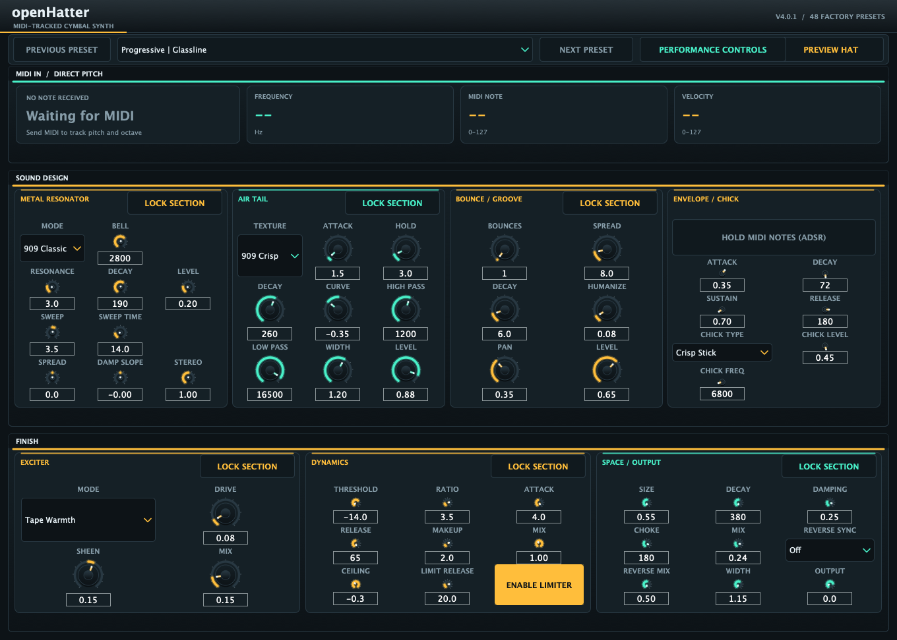
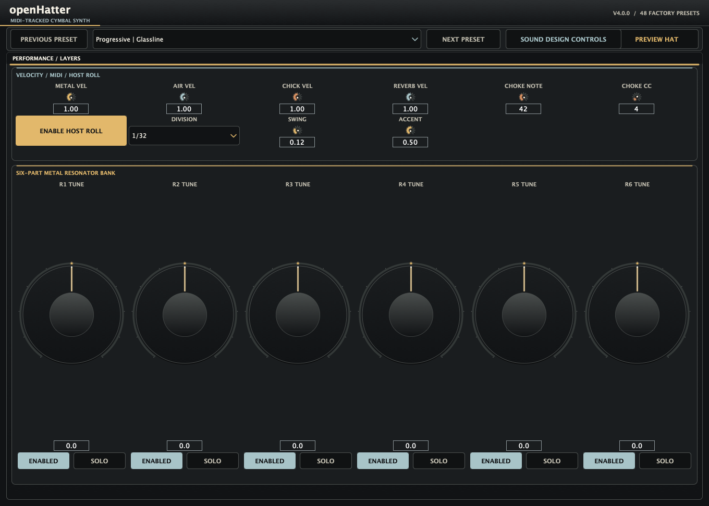
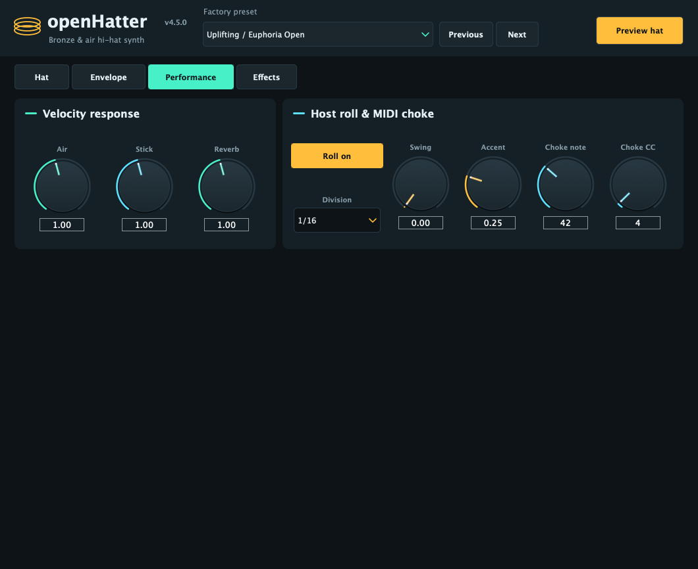

# openHatter v4.0.1

[Install with OpenVST Manager](https://github.com/alanmarcero/alan-m-OpenVSTManager/releases/latest)

openHatter is a pitched open hi-hat instrument for electronic music. Play MIDI notes to change the hat's pitch and octave. The editor displays the incoming note, velocity, and frequency. Shape a restrained tuned metal sound with a clear air layer and attack.

The 48 factory presets cover Progressive, Uplifting, Classic, Tech, Psy, and Club styles. Use Simple or Advanced controls to build sounds from the resonators, air, chick, transient, effects, and reverb.

## Shape the sound

- **Metal Resonator:** Choose a cymbal mode, then set bell focus, resonance, decay, pitch sweep, partial spread, damping, stereo width, and level.
- **Air Tail:** Set the noise texture, envelope, filters, stereo width, and level.
- **Bounce / Groove:** Add up to five stick bounces with adjustable spread, decay, humanization, pan, and level.
- **Envelope / Chick:** Set the optional held-note envelope and shape the chick type, level, and pitch.
- **Exciter and Dynamics:** Add drive, sheen, compression, and limiting.
- **Space / Output:** Set reverb, reverse swell, stereo width, and output level.

By default, each hit plays as a one-shot. Turn on **Hold MIDI Notes (ADSR)** to hold the metal and air until the matching MIDI note and channel end. Set release up to 20 seconds. **Preview Hat** plays the latest note, or C4 if no note has arrived.

## Perform with MIDI

Use the Performance page to set separate velocity curves for metal, air, chick, and reverb. Tune, mute, or solo the six resonators. Set the MIDI choke note (default 42) and choke CC (default 4) to stop a ringing hat. CC 7 controls output volume and CC 74 controls air brightness.

Enable **Roll** to repeat the most recent hit at host-synced eighth, sixteenth, or thirty-second notes. Add swing and an accent every fourth hit. Rolls pause when the host transport stops and end when a choke arrives.

Four optional stereo outputs provide separate metal, air, chick, and reverb stems. They are off by default. The stems include output gain but bypass shared effects and stereo width. Lock any of the six preset sections to keep its values while browsing. You can edit locked controls, and the lock state saves with the project.

## Screenshots

## Formats and license

VST3, AU, LV2, and Standalone formats are available on macOS, Windows, and Linux.

MIT License. See [LICENSE](LICENSE).
