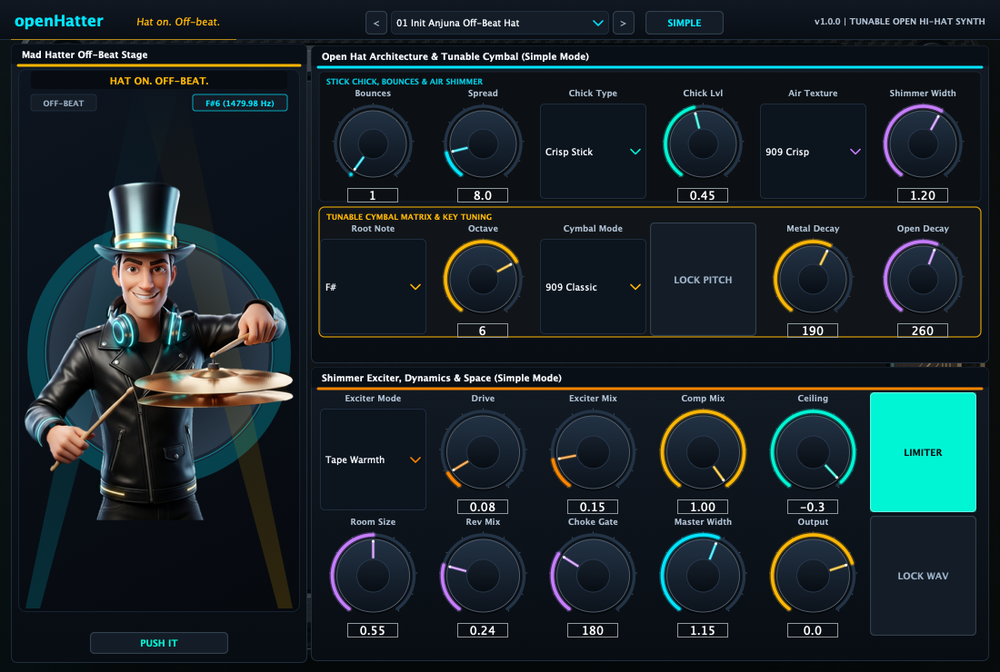
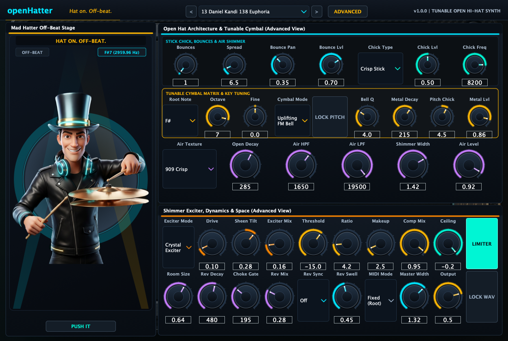

# openHatter

[Install with OpenVST Manager](https://github.com/alanmarcero/alan-m-OpenVSTManager/releases/latest)

Hat on. Off-beat.

openHatter is a tunable open hi-hat synthesizer plugin built for EDM and underground trance off-beats. It combines a 6-oscillator metallic cymbal matrix (`909 Classic`, `Anjuna Silk`, `Uplifting FM Bell`, `Analog 808 Crisp`) with chromatic root-note tuning across 8 octaves, fine cents control, pitch lock-in across preset browsing, stick bounce articulation, four air-sizzle noise textures, harmonic exciter saturation, compressor and brickwall limiter dynamics, gated FDN shimmer reverb, host-synced reverse cymbal swells, session WAV lock-in, and the animated Mad Hatter stage.

Available as VST3, AU, LV2, and Standalone on macOS, Windows, and Linux.





## Sound architecture

### Stick bounces and pre-chick articulation

Controls the stick micro-bounces that precede the main open cymbal ring.

| Parameter | ID | Range | Description |
|---|---|---|---|
| Bounces | `pre_bursts` | 1 to 5 | Number of stick micro-bounces before the open hat ring |
| Spread | `pre_spread` | 2.0 to 45.0 ms | Time spacing between bounces |
| Bounce Pan | `flam_spread` | 0.0 to 1.0 | Alternating stereo micro-panning width across bounces |
| Bounce Lvl | `pre_level` | 0.0 to 1.0 | Pre-chick bounce volume |

### Tunable cymbal matrix and metallic body

Provides the tuned 6-oscillator metallic partial cluster and resonant bell filter, with musical root note selection, octave register, and fine cents tuning.

| Parameter | ID | Range | Description |
|---|---|---|---|
| Cymbal Mode | `tone_mode` | 909 Classic, Anjuna Silk, Uplifting FM Bell, Analog 808 Crisp | 6-oscillator metallic synthesis topology |
| Root Note | `tone_note` | C through B | Musical root pitch |
| Octave | `tone_octave` | 1 to 8 | Octave register |
| Fine | `tone_fine` | -50 to +50 cents | Fine frequency tuning |
| Lock Pitch | `lock_pitch` | On / Off | Locks musical pitch across preset changes |
| Bell Q | `tone_q` | 0.5 to 12.0 | Bandpass filter resonance |
| Metal Decay | `tone_decay` | 15 to 800 ms | Metallic body decay envelope |
| Pitch Chick | `tone_pitch_env` | -24 to +24 semitones | Initial stick-impact pitch modulation |
| Metal Lvl | `tone_level` | 0.0 to 1.0 | Metallic matrix output volume |

### Air sizzle and shimmer noise

Shapes the high-frequency open hi-hat tail and stereo width.

| Parameter | ID | Range | Description |
|---|---|---|---|
| Air Texture | `noise_type` | 909 Crisp, Anjuna Silk, Velvet Shimmer, Lo-Fi Crunch | Noise spectrum source |
| Off-Beat Swell | `noise_attack` | 0.0 to 40.0 ms | Attack time for instant transient or off-beat pocket swell |
| Open Decay | `noise_decay` | 20 to 1200 ms | Open hi-hat tail decay time |
| Air HPF | `noise_hpf` | 100 to 6000 Hz | 12 dB/oct high-pass filter cutoff |
| Air LPF | `noise_lpf` | 1500 to 20000 Hz | 12 dB/oct low-pass filter cutoff |
| Shimmer Width | `noise_stereo_width` | 0.0 to 2.0 | Mid/Side stereo width (0 mono, 1 stereo, 2 wide) |
| Air Level | `noise_level` | 0.0 to 1.0 | Air sizzle level |

### Stick chick transient

Adds the initial stick tip, pedal foot, or laser tick transient.

| Parameter | ID | Range | Description |
|---|---|---|---|
| Chick Type | `click_type` | Crisp Stick, Pedal Foot, Laser Tick | Transient generator shape |
| Chick Lvl | `click_level` | 0.0 to 1.0 | Level of the initial transient |
| Chick Freq | `click_freq` | 1000 to 14000 Hz | Center frequency of the stick impulse |

### Shimmer exciter and saturation

Adds harmonic sheen or analog drive to the cymbal and air layers.

| Parameter | ID | Range | Description |
|---|---|---|---|
| Exciter Mode | `dist_type` | Tape Warmth, Tube Sheen, Hard Clip, Crystal Exciter | Transfer curve |
| Drive | `dist_drive` | 0.0 to 1.0 | Saturation drive (up to +24 dB internal gain) |
| Sheen Tilt | `dist_tone` | -1.0 to +1.0 | Post-saturation tilt filter (-1 dark, +1 bright) |
| Exciter Mix | `dist_mix` | 0.0 to 1.0 | Parallel saturation mix |

### Compressor and brickwall limiter

Dynamics processing stage for off-beat level consistency and peak control.

| Parameter | ID | Range | Description |
|---|---|---|---|
| Threshold | `comp_thresh` | -40.0 to 0.0 dB | Compressor threshold |
| Ratio | `comp_ratio` | 1.0:1 to 20.0:1 | Compression ratio |
| Attack | `comp_attack` | 0.1 to 50.0 ms | Compressor attack time |
| Release | `comp_release` | 10 to 500 ms | Compressor release time |
| Makeup | `comp_makeup` | 0.0 to 24.0 dB | Makeup gain |
| Comp Mix | `comp_mix` | 0.0 to 1.0 | Parallel compression blend |
| Ceiling | `limiter_ceiling` | -12.0 to 0.0 dB | Brickwall limiter ceiling |
| Release | `limiter_release` | 5 to 100 ms | Limiter release time |
| Limiter | `limiter_enabled` | On / Off | Engages the brickwall limiter |

### Shimmer reverb and choke gate

6-delay-line modulated FDN diffuser reverb with 220 Hz input high-pass filter and choke gate cutoff.

| Parameter | ID | Range | Description |
|---|---|---|---|
| Room Size | `reverb_size` | 0.1 to 1.0 | Room dimension scaling |
| Rev Decay | `reverb_decay` | 50 to 2500 ms | Tail reverberation time |
| Damping | `reverb_damp` | 0.0 to 1.0 | High-frequency damping factor |
| Choke Gate | `reverb_gate` | 0 to 600 ms | Gate choke time (0 disables gate) |
| Rev Mix | `reverb_mix` | 0.0 to 1.0 | Reverb dry/wet blend |

### Reverse swells and master

| Parameter | ID | Range | Description |
|---|---|---|---|
| Rev Sync | `reverse_mode` | Off, Beat End, Beat 4 Auto, 1/2 Beat, 1/4 Beat | Host tempo sync mode for reverse cymbal swell |
| Rev Swell | `reverse_mix` | 0.0 to 1.0 | Level of reverse cymbal swell |
| MIDI Mode | `midi_mode` | Fixed (Root), Note Tracking | Fixed pitch or MIDI note pitch tracking |
| Lock WAV | `lock_in` | On / Off | Bakes rendered open hat into session WAV memory |
| Master Width | `stereo_width` | 0.0 to 2.0 | Master stereo image width |
| Output | `output_gain` | -36.0 to +12.0 dB | Master output volume trim |

## Factory presets (48 EDM & underground trance presets)

| Index | Name | Style |
|---|---|---|
| 01 | Init Velvet Off-Beat Hat | Balanced F#6 velvet open hat with crisp air and tight gate |
| 02 | Sun & Moon Silk 909 | G#6 silky progressive trance hat with soft attack swell and wide sheen |
| 03 | Melodic Silk 909 | A6 classic 909 metallic matrix with clean high-passed air |
| 04 | Progressive Volume Classic | F6 dual-bounce progressive open hat with velvet shimmer tail |
| 05 | Silky Shimmer Velvet Hat | B6 airy velvet shimmer hat with gentle pedal chick |
| 06 | Tuned F# Open Hat | Resonant F#6 bell focus with tight 185 ms gated space |
| 07 | Deep Progressive Air | D6 warm progressive hat with soft attack and silk noise |
| 08 | Stadium Big Trance Hat | G6 stadium progressive hat with tube sheen and wide stereo image |
| 09 | Uplifting Sheen Hat | E6 FM bell partials with crystal exciter top end |
| 10 | Crisp Off-Beat Hat | C6 tight 225 ms decay for clean 128-132 BPM off-beat grooves |
| 11 | Club Pocket Hat | A#5 analog 808/909 hybrid with 4.5 ms sidechain pocket swell |
| 12 | Deep Warm Velvet Hat | A5 warm velvet noise open hat with gentle low-pass roll-off |
| 13 | Euphoria 138 Open Hat | F#7 uplifting FM bell hat with bright 19.5 kHz air and crystal sheen |
| 14 | Always Alive Sparkle | A7 high-register uplifting shimmer hat with wide stereo tail |
| 15 | Emotional Breakdown Hat | C#7 long 380 ms breakdown open hat with hall shimmer |
| 16 | Peak Time Dual Drive | E6 driving 909 peak-time hat with tube harmonic warmth |
| 17 | Euphoric Tuned C#7 | C#7 high-Q tuned bell-hat for melodic uplifting arrangements |
| 18 | Nordic Uplifting Silver Hat | B6 silky silver top end with velvet shimmer decay |
| 19 | Uplifting 140 BPM Hat | G7 fast-attack 140 BPM uplifting hat with laser tick transient |
| 20 | Titanium Laser Hat | E7 high-resonance FM bell hat with crystal exciter bite |
| 21 | Degenerate Acid Sizzle | A6 analog pulse matrix with lo-fi sizzle and hard clip punch |
| 22 | Rolling Off-Beat Tech Hat | F#6 short 195 ms open hat tailored for fast rolling basslines |
| 23 | Tech-Trance Snap Hat | D7 ultra-tight 180 ms tech-trance hat with 115 ms choke gate |
| 24 | Underground Warehouse Hat | F6 909 warehouse hat with tube drive and 12-bit sizzle |
| 25 | Celestial Trance Air | G#6 wide euphoric 909 open hat with 340 ms tail and hall space |
| 26 | Out Of The Blue 909 | F6 classic late-90s Dutch trance 909 open hat |
| 27 | Punk Driven Open Hat | E6 driven electro-trance hat with tube saturation |
| 28 | Carte Blanche 909 | A#6 bright classic uplifting 909 hat with wide stereo spread |
| 29 | Celestial Anahera Shimmer | D#7 expansive FM shimmer hat with 720 ms reverb decay |
| 30 | High-Tension Ride-Hat | G6 extended 350 ms ride-hat hybrid with resonant bell tone |
| 31 | Mainstage Off-Beat Hat | G6 punchy mainstage trance open hat with balanced compression |
| 32 | Trance 138 Anthem Open Hat | A6 uplifting anthem hat with FM bell partials and wide air |
| 33 | Melodic Progressive Pocket | D6 warm progressive off-beat hat with pedal chick |
| 34 | Who's Afraid Of 138?! Sizzle | F#7 high-energy 138 BPM sizzle hat with fast compressor catch |
| 35 | Dutch Trance 1999 Classic 909 | F#6 vintage 909 open hat with authentic 12-bit sizzle |
| 36 | FSOE Golden Hat | F7 golden uplifting hat with 1.75 kHz high-pass clarity |
| 37 | Live Rig Punch 909 | A6 punchy live-rig 909 open hat with tight 160 ms gate |
| 38 | Subculture Tech Hat | D7 driving underground subculture hat with crisp stick attack |
| 39 | Hard Tech Sizzle Hat | F#6 aggressive tech-trance hat with hard-clipped transient |
| 40 | Wake Your Mind Open Hat | E6 progressive tech-trance hat with analog pulse body |
| 41 | Arena Progressive Crisp Hat | G6 clean progressive house/trance off-beat hat |
| 42 | Electro House Pluck Hat | F6 short 155 ms tight electro open hat |
| 43 | Festival Mainstage Wide Hat | A6 ultra-wide 3-bounce festival open hat |
| 44 | Underground Bunker 808-909 | F#5 dark bunker 808/909 hybrid hat |
| 45 | Off-Beat Sidechain Swell Hat | F#6 14 ms attack swell for natural off-beat pump against kicks |
| 46 | Reverse Cymbal Pickup Hat | F#6 beat-synced reverse cymbal swell into open hat hit |
| 47 | Fast 16th Stutter Open Hat | A6 4-bounce stutter open hat with short 150 ms tail |
| 48 | Pure Zero-Drive Clean 909 | F#6 uncolored 909 open hat with zero distortion drive |

## MIDI implementation

All MIDI channels are received. Incoming MIDI note-on events trigger the voice. Note velocity scales synth volume, metallic body attack, and locked WAV playback. When MIDI mode is set to Note Tracking, the cymbal pitch transposes relative to the root note.

| Controller | Function |
|---|---|
| CC 7 | Master output volume |
| CC 74 | Air low-pass filter cutoff sweep |
| CC 120 / 123 | All sound off / all notes off (silences active voice) |
| CC 121 | Reset all controllers (resets CC 7 and CC 74 to 127) |

## Build

Building requires CMake 3.22 or newer and a C++20 compiler.

```sh
cmake -S . -B build -DCMAKE_BUILD_TYPE=Release
cmake --build build --config Release --parallel
ctest --test-dir build -C Release --output-on-failure
```

## Repository layout

| Path | Contents |
|---|---|
| `Source/Core` | C++20 DSP engine: `HatSynth`, `Effects`, and `HatEngine` |
| `Source/Plugin` | JUCE 8 plugin wrappers, UI controls, panels, parameters, presets |
| `Tests` | Catch2 unit test suite |
| `assets` | Faceplate graphics, Mad Hatter mascot, and live UI screenshots |
| `.github/workflows` | Multi-platform CI workflow for macOS, Windows, and Linux |

## License

MIT License. Copyright (c) 2026 Alan Marcero.
JUCE is dual-licensed under AGPL-3.0 or commercial license.
