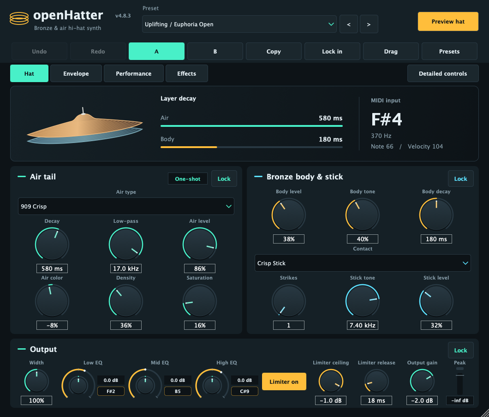

# openHatter v4.6.0

[Install with OpenVST Manager](https://github.com/alanmarcero/alan-m-OpenVSTManager/releases/latest)

openHatter is a spun-bronze and air hi-hat synthesizer built for trance and club drums. Pair an eight-mode hiss engine and bronzed modal shell resonators with a pitch-tracking stick strike, one-shot open tails up to 2.4 seconds, or held synth notes.

## Find a hat

Choose a **Factory preset** or step through the bank with **Previous** and **Next**. **Preview hat** plays a one-shot at the last incoming pitch, or C4 before the first note. The 56 factory sounds span six dance styles led by **24 Uplifting Trance** presets alongside 8 Rolling, 8 Progressive, 6 Psy, 5 Tech, and 5 Classic hats.

| Style | Try | What to listen for |
| --- | --- | --- |
| Uplifting | Euphoria Open / Skyward Wash | Full-bodied 138 BPM offbeats and long shimmering trance rides |
| Rolling | Heavy Floor Open | Solid club pocket with warm bronze shell weight |
| Progressive | Silk Offbeat | Smooth wide air tail and gentle stick attack |
| Psy | Spectral Orbit | Modulated comb shimmer and pitched laser transient |
| Tech | Industrial Bronze | Tight, saturated mid-bronze punch |
| Classic | 909 Full Bronze | Thick analog-machine open cymbals with long ring |

## Shape the hit

On **Hat**, **Hiss & air tail** selects from **8 Hiss Types** (*909 Crisp*, *Anjuna Silk*, *Velvet Shimmer*, *Lo-Fi Crunch*, *808 Analog Metal*, *Bronze Shimmer*, *Trance Sizzle*, and *Spectral Wash*) along with **Decay** (20–2400 ms), **Low-pass**, **Hiss level**, **Hiss color** tilt, **Density**, and pre-envelope analog **Saturation**. **Bronze body & stick** adds spun-bronze shell resonators (**Body level**, **Body tone**, **Body decay**) beneath the contact strike (**Strikes**, **Frequency**, **Strike level**). **Detailed controls** reveals air attack and hold (up to 120 ms), tail curve, high-pass, stereo width, decay morph, and bounce timing. **Output** puts the dual-layer 3-band EQ (±12 dB inner cap, smoothly gliding outer frequency collar), stereo width, output gain, and brickwall limiter directly on the main page.

The animated cymbal opens on the offbeat and follows the host through tempo changes and seeks. It rests when transport stops and uses a 138 BPM clock in Standalone. The dual decay bars show live **Hiss** and **Body** decay times in milliseconds. The MIDI monitor shows the last played note, frequency and velocity. Factory hats run from tight closed ticks around 70 ms to open rides past a second. Each section's **Lock** keeps its settings when browsing.

## Play sustained notes

Open **Envelope** and select **Hold notes**. Attack brings the air in, decay settles them at the sustain level, and a matching note-off on the same MIDI channel starts release. Release runs from zero to 20 seconds. Select **One-shot** to let the sound finish on its own. The four envelope controls also shape the one-shot within its natural tail. The selected play mode stays active when you browse presets.

## Performance and effects

On **Performance**, set separate velocity curves for air, stick and reverb. A note-off on the choke note (42 by default) or a high value on the choke CC (4) closes a ringing hat. CC 7 controls output volume and CC 74 controls air brightness. **Roll on** repeats the last hit at host-synced eighth, sixteenth or thirty-second notes. Set swing and a fourth-hit accent. Rolls pause with the host and end on a choke.

On **Effects**, shape the exciter, parallel compressor and reverb, or add a synced reverse swell. Output EQ, master width, output gain and limiting live on the **Hat** page under **Output**. Three optional stereo buses carry air, stick and reverb for separate mixing. They include output gain and bypass shared effects and master width.

[See the detailed Hat, Performance and Effects pages.](docs/SCREENSHOTS.md)

## Changes in 4.6

The hiss modes and bronze shell were retuned from their audio. 909 noise is a resonant hat rather than flat hiss, 808 metal is a highpassed ring of band-limited squares, and the bronze partials reach the air band and darken as they decay. The low chest thump and the DC offset from saturation are gone. Closed factory hats are actually short, open and ride hats keep a longer exponential tail, and the 56 presets are level-matched with the limiter left as a ceiling. Saved sessions keep their parameter values. Sessions saved before this bank show as **Custom sound** until a factory hat is chosen.

## Changes in 4.3

The tuned metal layer is gone, along with its resonators, model, spread, damping, ring mod, root pitch and Lock Pitch controls and the Metal output bus. The air layer no longer follows the played MIDI note, which had darkened it at low drum notes and silenced it near the top of the keyboard. Earlier sessions keep their remaining settings, but their metal layer no longer sounds.

## Changes in 4.1

The stick and pedal oscillators now fade individual overtones as they approach Nyquist. The laser strike follows a continuous downward pitch sweep and fades when it reaches the upper frequency limit. These changes also apply to stick bounces and held-note attacks. Earlier sessions retain their parameter values, MIDI behavior and section locks. The preset browser labels sounds from earlier banks **Custom sound** until you pick a new preset.

## Formats and license

The project builds VST3, LV2 and Standalone on macOS, Windows and Linux, plus AU on macOS. See the [latest release](https://github.com/alanmarcero/openHatter/releases/latest) for packaged downloads.

MIT License. See [LICENSE](LICENSE).
