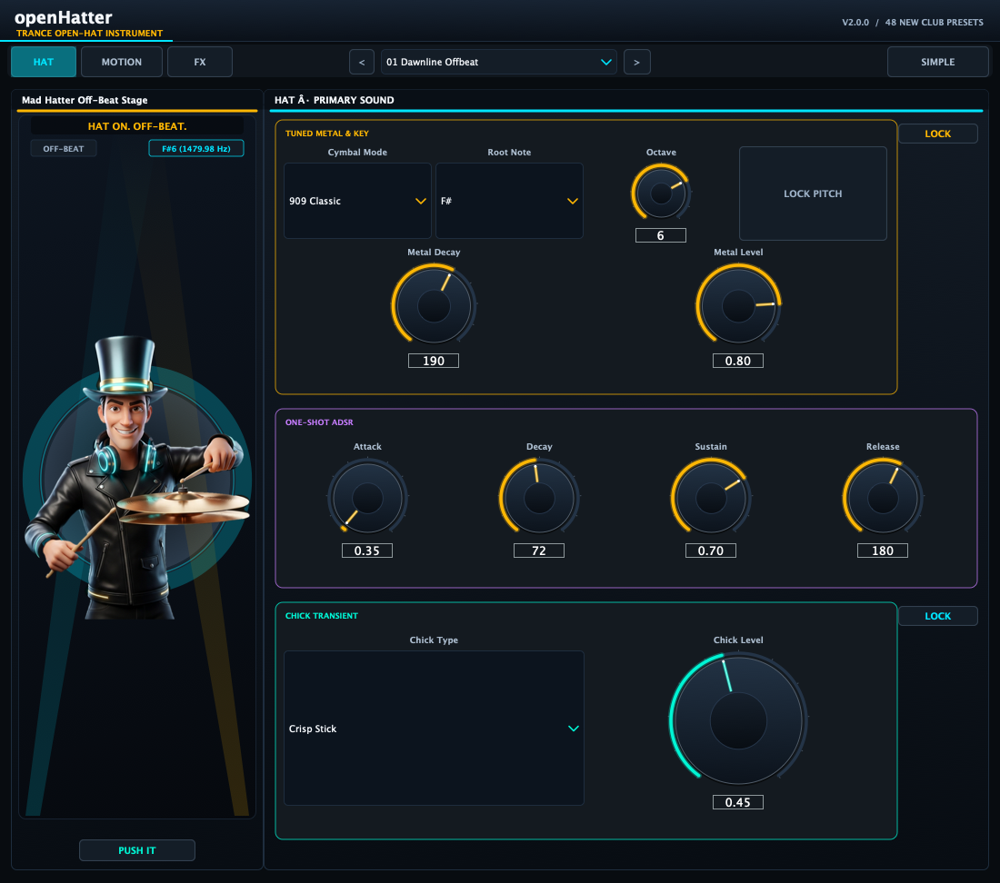
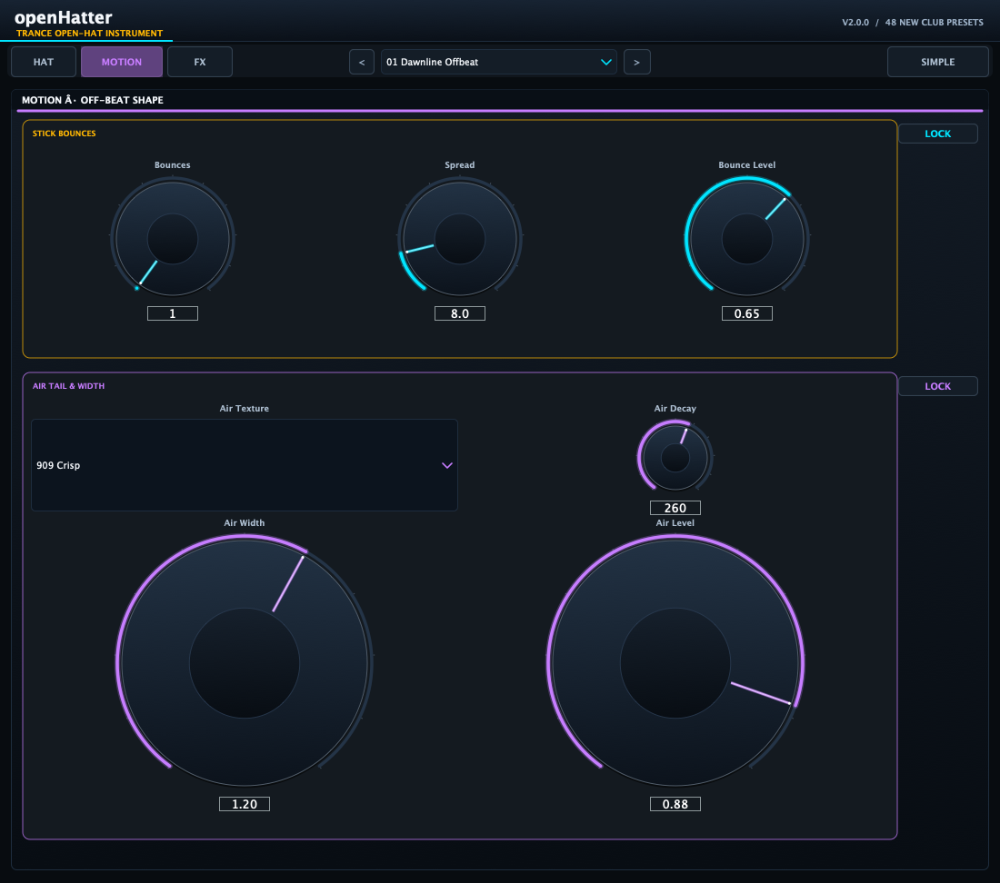
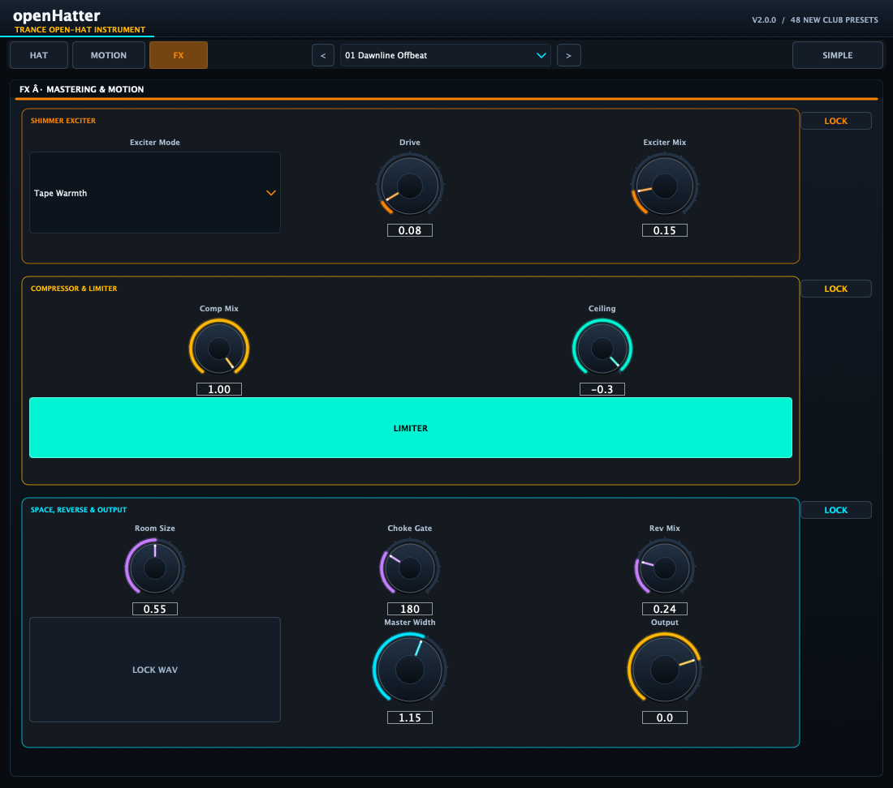

# openHatter v2

[Install with OpenVST Manager](https://github.com/alanmarcero/alan-m-OpenVSTManager/releases/latest)

Hat on. Off-beat.

openHatter is a tunable, trance-focused open hi-hat instrument. Version 2 replaces the voice, effects path, preset bank and editor while preserving the existing host identity, parameter IDs, MIDI behavior, state format and plugin formats. It includes four cymbal models, four air textures, stick and chick articulation, a one-shot ADSR, a lockable six-section preset workflow, exciter and dynamics, gated reverb, host-synced reverse swells, WAV lock-in, and the animated Mad Hatter stage.

Available as VST3, AU, LV2 and Standalone on macOS, Windows and Linux.







The editor is 1100 × 972. The Hat, Motion and FX pages retain the preset browser and Simple / Full Detail toggle. Simple mode surfaces the primary controls; Full Detail exposes every parameter. Screenshots from both modes were checked at the default editor size; see [the screenshot notes](docs/SCREENSHOTS.md).

## Sound controls

The UI groups controls into lockable sections. A section lock preserves that section when a factory preset changes; the controls remain editable by hand. Lock state is saved with the session. Existing Lock Pitch and Lock WAV controls are separate features.

| Section | Controls | Purpose |
|---|---|---|
| Articulation | Stick Bounces, Bounce Spread, Bounce Decay, Humanize, Bounce Pan, Bounce Level, Chick Type, Chick Level, Chick Freq | Pre-hit micro-bounces, stereo movement and the stick / pedal / laser transient |
| Cymbal & Tuning | Cymbal Mode, Root Note, Octave, Fine Tune, Lock Pitch, Bell Freq / Q, Metal Decay, Pitch Chick / Decay, Metal Level, ADSR | Tuned six-mode metallic body and its amplitude contour |
| Air | Air Texture, Attack, Hold, Decay, Tail Curve, HPF, LPF, Width, Level | Noise spectrum, off-beat swell, filtering, tail and stereo spread |
| Exciter | Exciter Mode, Drive, Sheen Tilt, Mix | Parallel tape, tube, clip or crystal-style harmonic shaping |
| Dynamics | Threshold, Ratio, Comp Attack / Release, Makeup, Comp Mix, Limiter Ceiling / Release / Enabled | Parallel compressor and output peak ceiling |
| Space & Output | Room Size, Reverb Decay / Damping / Choke / Mix, Reverse Sync / Swell, MIDI Mode, Lock WAV, Master Width, Output | Gated stereo ambience, beat-synced swell and final level / stereo controls |

### Parameter ranges

All existing host parameter IDs and version numbers are retained. New parameters use version 1 IDs `amp_attack`, `amp_decay`, `amp_sustain` and `amp_release`.

| Parameter | ID | Range |
|---|---|---|
| Stick bounces | `pre_bursts` | 1–5 |
| Bounce spread / decay | `pre_spread` / `pre_decay` | 2–45 ms / 2–35 ms |
| Bounce humanize / pan / level | `pre_jitter` / `flam_spread` / `pre_level` | 0–1 each |
| Cymbal mode | `tone_mode` | 909 Classic, Anjuna Silk, Uplifting FM Bell, Analog 808 Crisp |
| Root / octave / fine | `tone_note` / `tone_octave` / `tone_fine` | C–B / 1–8 / −50 to +50 cents |
| Bell frequency / Q | `tone_freq` / `tone_q` | 300–8000 Hz / 0.5–12 |
| Metal decay / pitch chick / pitch decay / level | `tone_decay`, `tone_pitch_env`, `tone_pitch_decay`, `tone_level` | 15–800 ms / −24 to +24 st / 3–80 ms / 0–1 |
| Pitch lock | `lock_pitch` | On / Off; preserves tuned pitch during preset browsing |
| ADSR attack / decay / sustain / release | `amp_attack`, `amp_decay`, `amp_sustain`, `amp_release` | 0.05–20 ms / 1–600 ms / 0–1 / 5–800 ms |
| Air texture | `noise_type` | 909 Crisp, Anjuna Silk, Velvet Shimmer, Lo-Fi Crunch |
| Air attack / hold / decay / curve | `noise_attack`, `noise_hold`, `noise_decay`, `noise_curve` | 0–40 ms / 0–30 ms / 20–1200 ms / −1 to +1 |
| Air HPF / LPF / width / level | `noise_hpf`, `noise_lpf`, `noise_stereo_width`, `noise_level` | 100–6000 Hz / 1500–20000 Hz / 0–2 / 0–1 |
| Chick type / level / frequency | `click_type`, `click_level`, `click_freq` | Crisp Stick, Pedal Foot, Laser Tick / 0–1 / 1000–14000 Hz |
| Exciter type / drive / tilt / mix | `dist_type`, `dist_drive`, `dist_tone`, `dist_mix` | Tape Warmth, Tube Sheen, Hard Clip, Crystal Exciter / 0–1 / −1 to +1 / 0–1 |
| Compressor threshold / ratio / attack / release | `comp_thresh`, `comp_ratio`, `comp_attack`, `comp_release` | −40–0 dB / 1:1–20:1 / 0.1–50 ms / 10–500 ms |
| Compressor makeup / mix | `comp_makeup`, `comp_mix` | 0–24 dB / 0–1 |
| Limiter ceiling / release / enabled | `limiter_ceiling`, `limiter_release`, `limiter_enabled` | −12–0 dB / 5–100 ms / On or Off |
| Reverb size / decay / damping / choke / mix | `reverb_size`, `reverb_decay`, `reverb_damp`, `reverb_gate`, `reverb_mix` | 0.1–1 / 50–2500 ms / 0–1 / 0–600 ms / 0–1 |
| Reverse sync / level | `reverse_mode`, `reverse_mix` | Off, Beat End, Beat 4 Auto, 1/2 Beat, 1/4 Beat / 0–1 |
| MIDI mode / WAV lock | `midi_mode`, `lock_in` | Fixed Root or Note Tracking / On or Off |
| Master width / output gain | `stereo_width`, `output_gain` | 0–2 / −36 to +12 dB |

The ADSR shapes the dry hit inside the selected cymbal / air tail. It does not shorten the reverb tail. Each layer retains its own decay controls.

## Factory presets

All previous factory programs have been replaced. The new bank contains exactly 48 complete, uniquely named trance and club presets.

| # | Preset | Focus |
|---:|---|---|
| 01 | Dawnline Offbeat | Progressive |
| 02 | Blueglass Horizon | Progressive shimmer |
| 03 | Silver Transit | Clean silver |
| 04 | Euphoric Afterglow | Uplifting |
| 05 | Quiet Beacon | Soft off-beat |
| 06 | Cloud Atlas Swing | Wide progressive |
| 07 | Sunrise Pulse | Mainstage lift |
| 08 | Velvet Skyline | Silk tail |
| 09 | Crystal Lift 138 | 138 BPM uplifting |
| 10 | Sapphire Bellline | Tuned bell |
| 11 | Aurora Step | Bright trance |
| 12 | Open Gate Euphoria | Long gated lift |
| 13 | Lucent Rise | Uplifting shimmer |
| 14 | Starlight Division | Wide air |
| 15 | Halo Spread | Stereo lift |
| 16 | Mainstage Daybreak | Festival off-beat |
| 17 | Dutch Signal 1998 | Classic Dutch |
| 18 | Four on the Horizon | Classic trance |
| 19 | Silver Kicker Hat | Tight kick slot |
| 20 | Intercity Resonance | Classic tuned metal |
| 21 | Clubland Memory | Retro club |
| 22 | Amber Overdrive | Driven classic |
| 23 | Festival Dialtone | Mainstage snap |
| 24 | Midnight Warehouse | Dark warehouse |
| 25 | Gridrunner Snap | Tech-trance |
| 26 | Voltage Triplet | Driving articulation |
| 27 | Circuit Halo | Bright tech |
| 28 | Pulse Climber | Rising tech |
| 29 | Hardline Sizzle | Tight, bright |
| 30 | Chrome Sawtooth | Hard-edged |
| 31 | Nocturne 140 | 140 BPM club |
| 32 | Strobe Relay | Tech-trance snap |
| 33 | Psychedelic Comet | Psy-trance |
| 34 | Fractal Shimmer | Psy shimmer |
| 35 | Forest Gate | Dark psy |
| 36 | Spiral Bloom | Rolling psy |
| 37 | Orbital Rattle | Percussive motion |
| 38 | Deep Space Chirp | Resonant psy |
| 39 | Acid Moonlight | Acid off-beat |
| 40 | Solar Flare Roll | Rolling lift |
| 41 | Studio Air 01 | Clean reference |
| 42 | Dry Club Utility | Dry and tight |
| 43 | Wide Room Silver | Wide room |
| 44 | Tight Offbeat | Short decay |
| 45 | Balearic Motion | Soft stereo |
| 46 | Satin Cymbal | Smooth body |
| 47 | Afterhours Brush | Gentle texture |
| 48 | Neutral Silver Reference | Neutral starting point |

Each preset defines the complete sound. Locked sections keep their current values during preset changes; unlocked sections take the preset's values.

## MIDI and state

The instrument receives MIDI on every channel. Note-on triggers the hat; velocity scales the sound. **Fixed (Root)** plays the tuned root. **Note Tracking** transposes from the root to the incoming note. Push It auditions the sound.

| MIDI CC | Function |
|---|---|
| 7 | Output volume |
| 74 | Air low-pass sweep |
| 120 / 123 | Silence active voice and queued playback |
| 121 | Reset CC 7 and CC 74 to 127 |

Lock Pitch and Lock WAV remain separate musical and render controls. WAV lock-in stores the current rendered hat in session state. Saved lock flags are session data and default to unlocked when an older session is loaded.

## Build

Requires CMake 3.22 or newer and a C++20 compiler. JUCE 8 and Catch2 are fetched by CMake.

```sh
cmake -S . -B build -DCMAKE_BUILD_TYPE=Release
cmake --build build --config Release --parallel
ctest --test-dir build -C Release --output-on-failure
```

## Repository layout

| Path | Contents |
|---|---|
| `Source/Core` | C++20 synthesis, effects and engine |
| `Source/Plugin` | JUCE parameters, state, preset bank, editor and controls |
| `Tests` | Catch2 unit and plugin tests |
| `assets` | Plugin artwork and v2 page screenshots |
| `docs` | Audio and screenshot notes, v2 design and plan |
| `.github/workflows` | Multi-platform package and release workflow |

## License

MIT License. Copyright (c) 2026 Alan Marcero. JUCE is dual-licensed under AGPL-3.0 or a commercial license.
