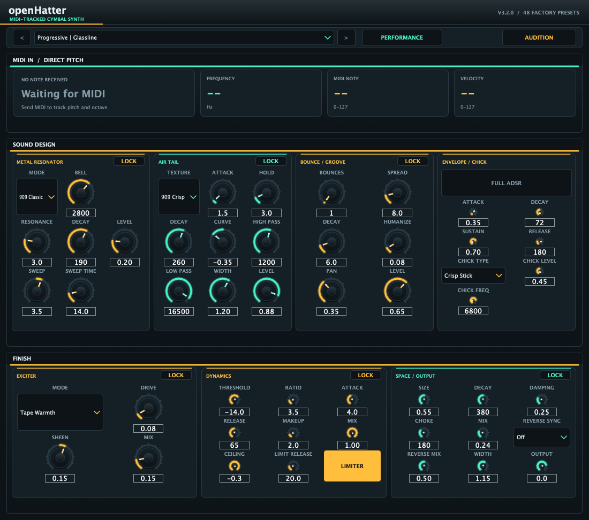

# openHatter v3.2

[Install with OpenVST Manager](https://github.com/alanmarcero/alan-m-OpenVSTManager/releases/latest)

openHatter is a MIDI-tracked open hi-hat synthesizer. Play any MIDI note and the synth follows its pitch and octave directly. The editor shows the received note, MIDI number, velocity, and calculated frequency. There are no pitch or octave selectors.



Version 3.2 adds an optional MIDI-tracked Full ADSR envelope with release up to 20 seconds. The engine matches note-offs by MIDI note and channel, keeps note timing sample-accurate, and leaves the default one-shot behavior unchanged. Version 3.1 trims the tuned metallic level by 12 dB across all 48 factory presets and the fresh-instance default. Presets span Progressive, Uplifting, Classic, Tech, Psy, and Club styles. The sound combines an inharmonic modal cymbal bank, shaped noise, stick bounces, transient controls, exciter, dynamics, gated space, and reverse swells.

Available as VST3, AU, LV2, and Standalone on macOS, Windows, and Linux.

## MIDI pitch tracking

Every MIDI note-on triggers the sound at the note's equal-tempered frequency:

```text
frequency = 440 × 2 ^ ((MIDI note − 69) / 12)
```

The first modal partial follows that frequency. Upper partials use the selected cymbal mode's inharmonic ratios, and partials above Nyquist are omitted. Chick pitch and the air filter cutoffs follow the incoming note while the noise remains broadband. By default, MIDI note-offs leave the one-shot hat tail unchanged. Turn on **Full ADSR** in Envelope / Chick to hold the metal and air layers through sustain and release them from the matching note and MIDI channel. Release reaches 20 seconds. The configurable choke note (default 42) closes the hat; the configurable choke CC (default 4) does the same at values of 64 or higher. Velocity scales each hit.

The note monitor reports the most recent incoming note. **Audition** plays that note, or MIDI note 60 (C4) before any MIDI note arrives. MIDI CC 7 controls output volume and CC 74 controls air brightness.

The **Performance** page has independent velocity curves for metal, air, chick, and reverb, plus six resonator tuning, mute, and solo controls. Enable **Roll** to repeat the most recent MIDI hit on host-synced eighth, sixteenth, or thirty-second notes. Swing delays alternating steps and accent raises every fourth hit. Rolls pause while the host transport is stopped and stop when the configured choke note or CC is received.


Four optional stereo outputs expose the metal, air, chick, and reverb stems. They are disabled by default to preserve the usual stereo output layout. Stems include the master output gain and CC 7 level, but bypass the shared exciter, compressor, limiter, and width processing.

## Controls

| Section | Controls |
|---|---|
| Metal Resonator | Cymbal mode, bell focus, resonance, decay, upper-mode sweep and time, level |
| Air Tail | Texture, attack, hold, decay, curve, high-pass, low-pass, stereo width, level |
| Bounce / Groove | Bounce count, spread, decay, humanize, pan, level |
| Envelope / Chick | Optional Full ADSR; attack, decay, sustain, release up to 20 seconds; chick type, level, frequency |
| Exciter | Mode, drive, sheen, mix |
| Dynamics | Compressor threshold, ratio, attack, release, makeup, mix; limiter ceiling, release, enable |
| Space / Output | Reverb size, decay, damping, choke, mix; reverse sync and mix; stereo width and output |
| Performance | Layer velocity curves; resonator tuning, mute and solo; MIDI choke note and CC; host-synced roll division, swing and accents |

The six preset sections can be locked while browsing. A lock keeps that section's values when another preset is selected; its controls remain editable. Lock states are saved with the project.

## Factory presets

All v2 factory programs have been replaced. The 48 new presets are grouped by style:

| Style | Presets |
|---|---|
| Progressive | Glassline, Night Current, Long Exposure, Paper Lantern, Meridian, Soft Focus, Copper Thread, Wide Stillness |
| Uplifting | Skywall, Radiant Spray, Climb Marker, Last Chorus, High Window, Blue Arpeggio, Summit Bloom, Open Sky |
| Classic | Tape Bronze, Warm Press, 909 Chamber, Soft Machine, Polished Rim, Backroom Velvet, Edge of Vinyl, Warm Room |
| Tech | Hard Relay, Grid Slicer, Steel Staccato, Notch Driver, Dry Circuit, Torque Stack, Voltage Bridge, Small Machine |
| Psy | Prism Orbit, Fractal Dust, Jungle Glass, Phase Bloom, Molecular, Starfield, Spiral Ratchet, Deep Sun |
| Club | Neutral Open, Tight Eighths, Wide Hall, Small Room, Felt Brush, Bright Cut, Subtle Air, Reference Plate |

## State and compatibility

The plugin identity, format IDs, and existing parameter IDs remain compatible with v2 sessions. Full ADSR is a new parameter and is off by default, so existing sessions retain one-shot note behavior. Legacy root note, octave, fine tune, pitch lock, MIDI mode, and WAV-lock parameter IDs remain for state migration; they do not select the live voice's pitch. Any cached v2 WAV render is discarded. MIDI input always sets the sounding pitch.

## Build

Requires CMake 3.22 or newer and a C++20 compiler. JUCE 8 and Catch2 are fetched by CMake.

```sh
cmake -S . -B build -DCMAKE_BUILD_TYPE=Release
cmake --build build --config Release --parallel
ctest --test-dir build -C Release --output-on-failure
```

## Repository layout

| Path | Contents |
|---|---|
| `Source/Core` | C++20 synthesis, effects, and MIDI engine |
| `Source/Plugin` | JUCE parameters, state, presets, editor, and controls |
| `Tests` | Catch2 unit and plugin tests |
| `assets` | Plugin artwork and editor screenshots |
| `docs` | Audio design and screenshot notes |
| `.github/workflows` | Multi-platform build, package, and release workflow |

## License

MIT License. Copyright (c) 2026 Alan Marcero. JUCE is dual-licensed under AGPL-3.0 or a commercial license.
