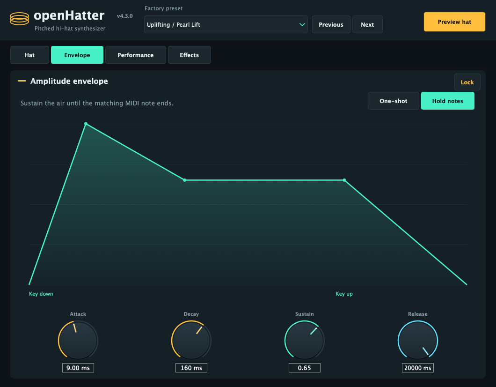

# openHatter v4.4.0

[Install with OpenVST Manager](https://github.com/alanmarcero/alan-m-OpenVSTManager/releases/latest)

openHatter is a hi-hat synthesizer built from filtered air and a stick or pedal strike. Use one-shots for sequenced offbeats, or hold a key to sustain the hat as a synth voice.

## Find a hat

Choose a **Factory preset** or step through the bank with **Previous** and **Next**. **Preview hat** plays a one-shot at the last incoming pitch, or C4 before the first note. The 56 factory sounds span six dance styles: 16 Uplifting and eight each of Rolling, Progressive, Psy, Tech, and Classic.

| Style | Try | What to listen for |
| --- | --- | --- |
| Uplifting | Long Arc | Bright, open air between kick hits |
| Rolling | Main Floor | An even offbeat with a firm leading edge |
| Progressive | Silk Offbeat | A soft, wide air tail |
| Psy | Twin Pulses | Two close strikes with a pitched laser tick |
| Tech | Dry Contact | A narrow, short hat with a defined attack |
| Classic | Pressed Bronze | A stick strike and rounded 909-style air |

## Shape the hit

On **Hat**, set **Air tail** decay, low-pass cutoff and level for the length, brightness and weight of the hat. The air filters follow the knobs, not the played note, so every MIDI note keeps the same bright tail. **Stick & bounce** sets the contact type, strike count, frequency and level. **Detailed controls** opens air attack and hold, curve, high-pass, width and decay morph, plus bounce timing. **Output** puts the dual-layer 3-band EQ (±12 dB inner cap, smoothly gliding outer frequency collar), stereo width, output gain, and brickwall limiter directly on the main page.

The animated cymbal opens on the offbeat and follows the host through tempo changes and seeks. It rests when transport stops and uses a 138 BPM clock in Standalone. The decay bar shows the current air decay in milliseconds. The MIDI monitor shows the last played note, frequency and velocity. The factory hats use 113–242 ms air decay. Each section's **Lock** keeps its settings when browsing. The Envelope page has its own lock for the amplitude envelope. You can edit a locked control and save the lock state with your project.

## Play sustained notes

Open **Envelope** and select **Hold notes**. Attack brings the air in, decay settles them at the sustain level, and a matching note-off on the same MIDI channel starts release. Release runs from zero to 20 seconds. Select **One-shot** to let the sound finish on its own. The four envelope controls also shape the one-shot within its natural tail. The selected play mode stays active when you browse presets.

## Performance and effects

On **Performance**, set separate velocity curves for air, stick and reverb. A note-off on the choke note (42 by default) or a high value on the choke CC (4) closes a ringing hat. CC 7 controls output volume and CC 74 controls air brightness. **Roll on** repeats the last hit at host-synced eighth, sixteenth or thirty-second notes. Set swing and a fourth-hit accent. Rolls pause with the host and end on a choke.

On **Effects**, shape the exciter, parallel compressor and reverb, or add a synced reverse swell. Output EQ, master width, output gain and limiting live on the **Hat** page under **Output**. Three optional stereo buses carry air, stick and reverb for separate mixing. They include output gain and bypass shared effects and master width.

[See the detailed Hat, Performance and Effects pages.](docs/SCREENSHOTS.md)

## Changes in 4.3

The tuned metal layer is gone, along with its resonators, model, spread, damping, ring mod, root pitch and Lock Pitch controls and the Metal output bus. The air layer no longer follows the played MIDI note, which had darkened it at low drum notes and silenced it near the top of the keyboard. Earlier sessions keep their remaining settings, but their metal layer no longer sounds.

## Changes in 4.1

The stick and pedal oscillators now fade individual overtones as they approach Nyquist. The laser strike follows a continuous downward pitch sweep and fades when it reaches the upper frequency limit. These changes also apply to stick bounces and held-note attacks. Earlier sessions retain their parameter values, MIDI behavior and section locks. The preset browser labels sounds from earlier banks **Custom sound** until you pick a new preset.

## Formats and license

The project builds VST3, LV2 and Standalone on macOS, Windows and Linux, plus AU on macOS. See the [latest release](https://github.com/alanmarcero/openHatter/releases/latest) for packaged downloads.

MIT License. See [LICENSE](LICENSE).
