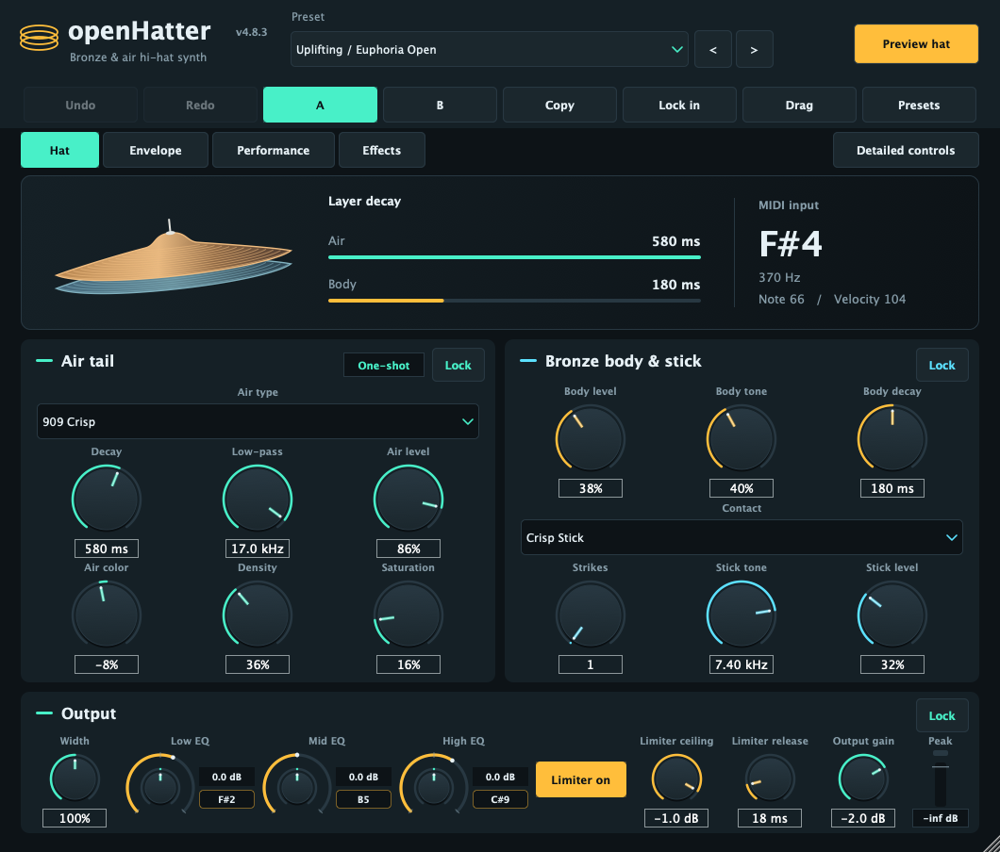
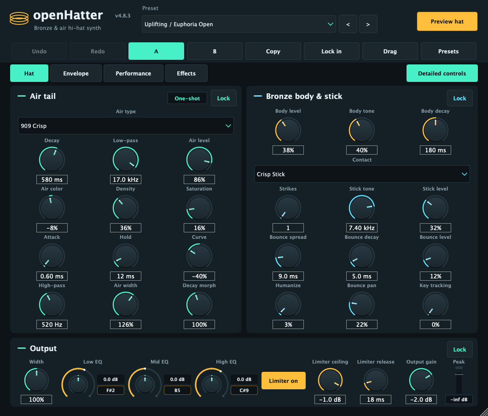
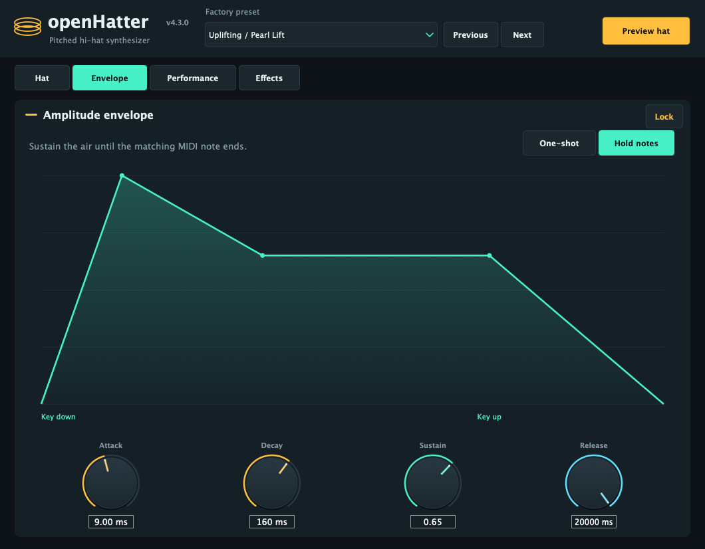
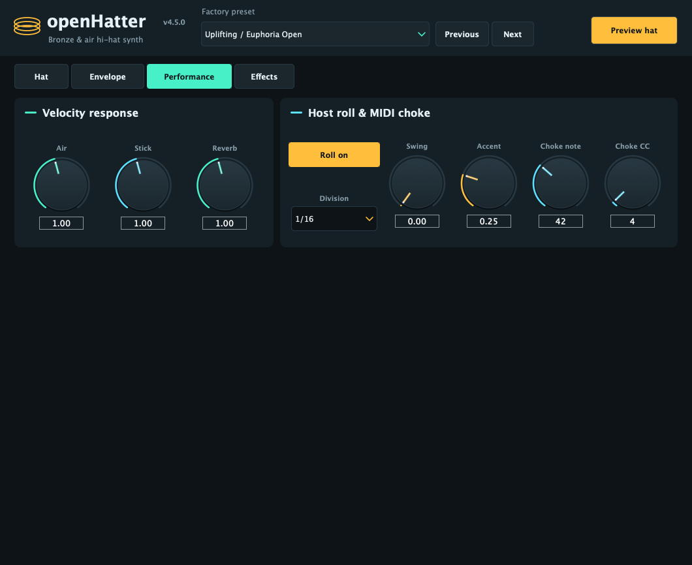
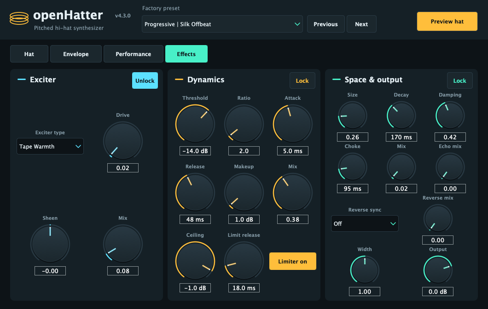

# Native openHatter editor

The 1060 × 866 captures come from the JUCE editor. The Hat page shows a MIDI F♯4 at velocity 104. Its layered cymbal is a bundled SVG animated from the musical clock. The Envelope capture shows a held voice with a 20-second release.











Regenerate all five captures from the repository root with a release build of the plug-in tests.

```sh
OPENHATTER_CAPTURE_DIR="$PWD/assets" build/openhatter_plugin_tests '[plugin][gui]'
```


## OpenVST Manager preview

OpenVST Manager shows `docs/screenshots/preview.png` from `main` (see `screenshotPath` in its catalog), and the GitHub release body and README hero point at the same file. This is the single image to keep current. Refresh it with the main editor capture whenever the UI changes, and commit it before tagging a release:

```sh
mkdir -p build/shots && OPENHATTER_CAPTURE_DIR="$PWD/build/shots" build/openhatter_plugin_tests '[plugin][gui]'
cp build/shots/openHatter-hat.png docs/screenshots/preview.png
```
